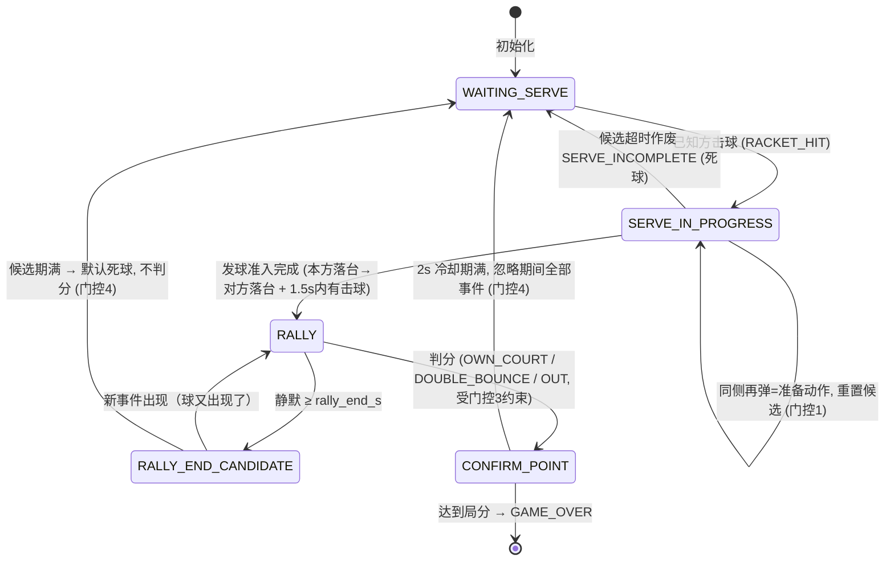

# 乒乓球计分状态机与规则规范

依据国际乒联（ITTF）基本竞赛规则、实验室统一方案，以及学长 2026-11-04 布置的
四条"参考门控"设计。实现见 `core/state_machine.py`。

状态机坚持原则：**状态机只负责"谁该得分"，不负责"发生了什么"**；物理事件由上游
轨迹层或外部硬件输入驱动。另一条同等重要的原则（门控版核心思想）：

> **宁可漏判，不可误判。** 证据不足时默认不判分（死球/清理证据），
> 每道门挡掉了什么都有计数（`describe()["gates"]`），可量化、可消融。

---

## 一、状态转移图（6 状态）



### 状态枚举定义（与代码 `MatchState` 一致）
* `WAITING_SERVE`：等待发球。
* `SERVE_IN_PROGRESS`：**发球准入候选**。等待"本方半台落台 → 对方半台落台"序列；
  期间的同侧再弹（颠球/拍球找手感）视为准备动作，重置候选、绝不判罚。
* `RALLY`：**可判分对打**（已通过准入）。小球在双方半台交替反弹。
* `RALLY_END_CANDIDATE`：回合结束候选（静默缓冲，期满默认死球）。
* `CONFIRM_POINT`：判分后冷却（2s），忽略全部事件。
* `MANUAL_REVIEW`：预留的人工确认状态（触发条件待组长定义，A7）。

---

## 二、判罚规则（每条可独立开关）

通过 `core/state_machine.py` 中的 `MatchRules` 配置。**所有判分均受门控 3a 约束**：
升级后的回合内至少出现过一次已知击球。

| 规则名称 | 规则含义 | 判罚结果 | 代码开关 | 默认 |
| :--- | :--- | :--- | :--- | :--- |
| `DOUBLE_BOUNCE` | 双跳违例：球在同一半台连续反弹两次（中间无击球）而接球方未击出 | 另一方得分 | `enable_double_bounce` | 开 |
| `OWN_COURT` | 自杀落台：击球方将球打在自己半台内反弹 | 对手得分 | `enable_own_court` | 开（受门控 3b 约束，见下） |
| `OUT` | 出界违例：球在台外发生落点拐点 | 击球方的对手得分 | `enable_out` | 开 |
| `NO_RETURN` | 绝杀未回击：球落在对方半台后消失 | 击球方得分 | `enable_no_return` | **关**（门控 4：静默默认不判分） |
| `SERVE_FAULT` | 发球违例：未先落本方半台 | 接发方得分 | `enable_serve_fault`（仅旧版模式） | 开（开关默认开；门控 1 开启时不可达，被其取代） |

---

## 三、四条参考门控（学长 2026-11-04 布置）

针对 Test4 实测暴露的两大误判源（虚假击球洪流、发球前颠球被判 DOUBLE_BOUNCE
抢跑送分，见 `test4_evaluation_report.md`）：

### 门控 1：发球准入（`enable_serve_admission=True`）
* 必须见证 **"本方台面落台 → 对方台面落台"** 序列，回合才升为可判分；
* 准入期间**同侧再弹视为发球前的准备动作**（颠球/拍球找手感），重置候选、
  绝不判 DOUBLE_BOUNCE——修复 Test4 帧 828 的抢跑误判（比赛未开先送 0:1）；
* 未先落本方半台（序列不成立）**不判 SERVE_FAULT**（多半是己方第一跳被漏检），
  候选保持等待；始终无法完成序列则超时作废（死球，不判分）；
* 关闭本门控退回旧版发球判分（SERVE_FAULT / 发球二跳）。

### 门控 2：发球前击球校验（`pre_serve_hit_window_s=1.5`）
* 准入序列完成（升级）时刻，最近一次 `RACKET_HIT` 必须在此窗口内；
* **手抛传球、滚球等没有球拍接触的弹跳序列直接挡下**；
* 实测依据：真实发球从击球到对方半台落台约 0.5~1.1s，1.5s 留有余量。

### 门控 3：回合内击球要求（`enable_rally_hit_required` / `enable_splice_guard`）
* **3a** 升级后的回合内**至少一次已知击球**才允许任何判分——发球 ace、发球二跳
  这类"接发方从未触球"的得分一律放过（宁漏勿误）；
* **3b** "同侧两弹之间夹一次击球"视为**序列误拼**（虚假击球 + 漏检拼接的典型
  形态），不计分。注意：真实的 OWN_COURT 天然呈同侧夹击球形态，因此门控 3b
  开启时 OWN_COURT 几乎不再触发；需要敏感度时关闭 3b。

### 门控 4：判分后冷却与默认不判分（`score_cooldown_s=2.0` / `enable_no_return=False`）
* 判分后进入 `CONFIRM_POINT` 冷却 **2s**，**忽略全部事件**（捡球、庆祝、地板
  反光都进不来）；换发在判分瞬间计算（HUD 即时显示下一轮发球方），
  回合证据清理推迟到冷却期满；
* **静默超时与视频结束默认只清理证据、不判分**（`NO_RETURN` 默认关闭，
  回合消失一律记死球）。

---

## 四、发球轮次与赛制配置

* **发球轮换**：标准比赛每 2 分轮换一次发球权（`serve_rotation=2`）；
* **平分追分 (Deuce)**：当双方打到 10:10 之后，自动切入"每 1 分轮换发球"
  （`deuce_serve_rotation=1`）；
* **局点判定**：得分 ≥ 11 且净胜 2 分时，自动触发 `game_over=True`；
* **换发时机**：判分瞬间按最新比分计算（冷却期内即生效）。

---

## 五、消融与回滚

四条门控全部参数化，关回旧值即恢复 2026-10-26 版行为：

```python
MatchRules(
    enable_serve_admission=False,      # 门控1 关
    enable_rally_hit_required=False,   # 门控3a 关
    enable_splice_guard=False,         # 门控3b 关
    score_cooldown_s=0.0,              # 门控4 冷却关
    enable_no_return=True,             # 门控4 默认不判分 → 关
)
```

端到端脚本对应开关：`tests/run_end_to_end.py --legacy-serving
--no-rally-hit-required --no-splice-guard --enable-no-return`。
