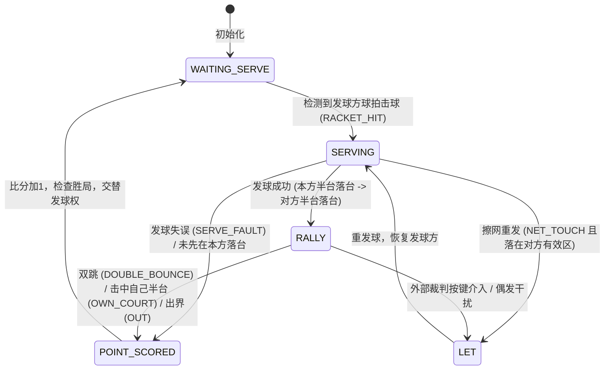

# 乒乓球计分状态机与规则规范

依据国际乒联（ITTF）基本竞赛规则与实验室统一方案设计。

状态机坚持原则：**状态机只负责“谁该得分”，不负责“发生了什么”**；物理事件由上游轨迹层或外部硬件输入驱动。

---

## 一、状态转移图 (6 状态)

### 状态枚举定义
* `WAITING_SERVE`：等待发球。双方准备阶段。
* `SERVING`：发球进行中。必须严格校验“本方半台跳 -> 越过球网 -> 对方半台跳”的三段轨迹。
* `RALLY`：常规回合对拉中。小球在双方半台交替反弹。
* `POINT_SCORED`：得分产生。执行加分判定，清零连击计数器。
* `LET`：重发球（不判罚任何一方失分）。
* `FAULT`：违例发生（过渡态，随即转入 POINT_SCORED）。

---

## 二、实现的判罚规则（每条可独立开关）

通过 `core/state_machine.py` 中的 `MatchRules` 进行配置：

| 规则名称 | 规则含义 | 默认判罚结果 | 代码开关 |
| :--- | :--- | :--- | :--- |
| `SERVE_FAULT` | 发球违例：发球未能先在本方半台落台，或发球直接飞向对手/出界 | 对手得分 | `enable_serve_fault=True` |
| `DOUBLE_BOUNCE`| 双跳违例：球在同一半台连续反弹两次而接球方未击出 | 另一方得分 | 核心物理规则，始终开启 |
| `OWN_COURT` | 自杀落台：击球方直接将球打在自己半台内反弹 | 对手得分 | 核心物理规则，始终开启 |
| `OUT` | 出界违例：球飞出球台有效边界并在台外下落反弹 | 击球方的对手得分 | `enable_out=True` |
| `NO_RETURN` | 绝杀未回击：球落在对方半台后消失（对手未能触碰） | 击球方得分 | `enable_no_return=True` |

---

## 三、发球轮次与赛制配置

* **发球轮换**：标准比赛每 2 分轮换一次发球权（`points_per_serve=2`）；
* **平分追分 (Deuce)**：当双方打到 10:10 之后，自动切入“每 1 分轮换发球”；
* **局点判定**：领先达到 2 分且得分 $\ge 11$ 分时，自动触发 `game_over=True`。
